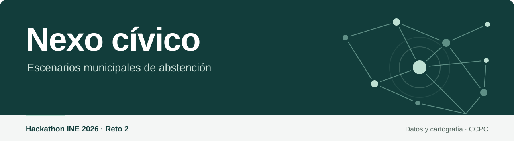
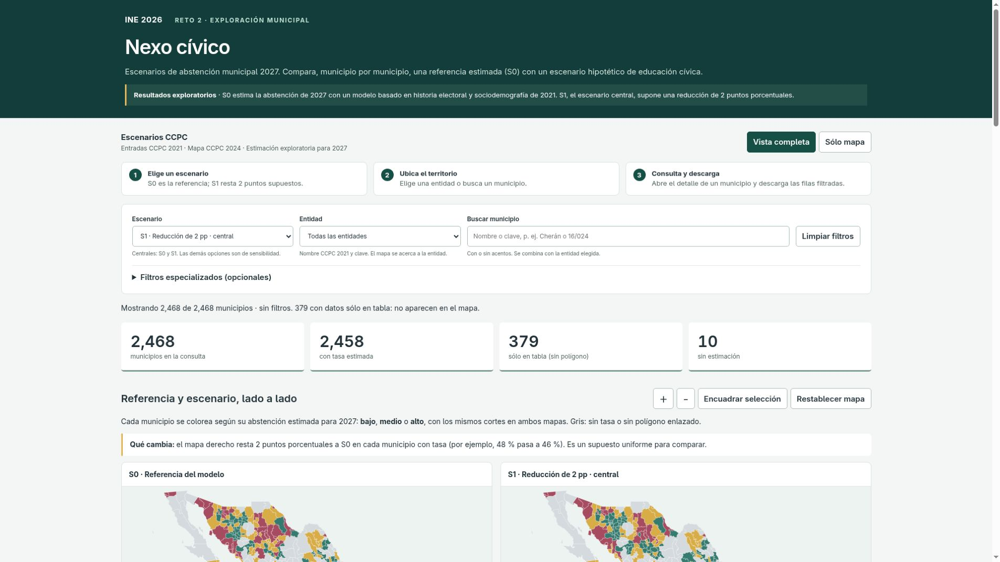
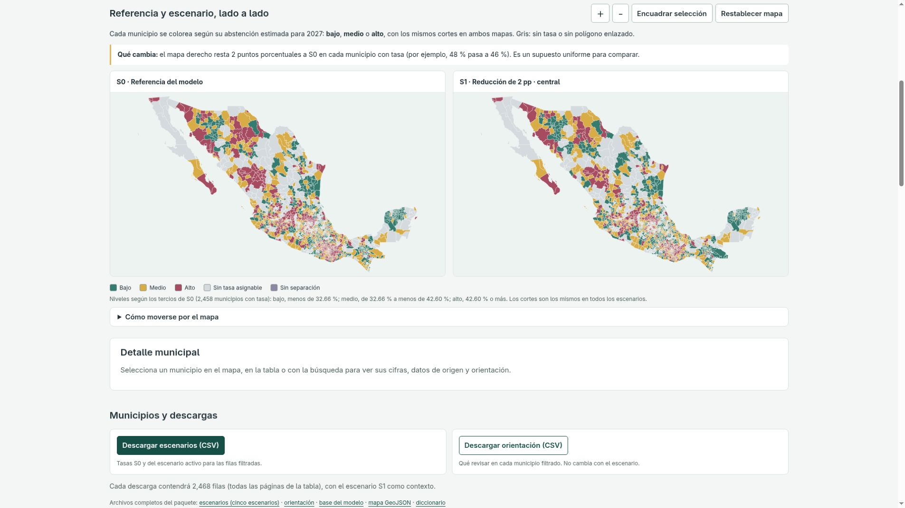
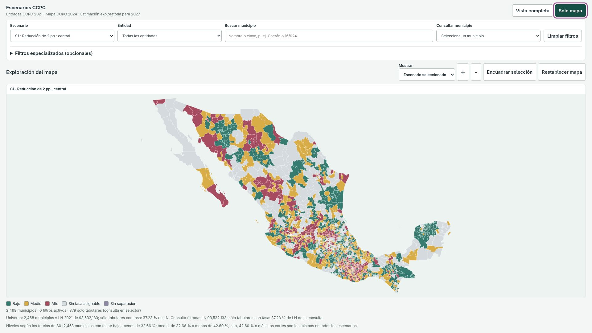

<p align="center">
  
</p>

<div align="center">

[](#abrir-el-visor)
[](#usar-el-visor)
[](#cómo-leer-los-resultados)
[](#qué-csv-consultar)
[](#usar-el-geojson)
[](#capturas-del-visor)
[](#si-algo-no-abre)

</div>

Este paquete permite consultar, municipio por municipio, una estimación
exploratoria de abstención para 2027 y compararla con escenarios hipotéticos
de educación cívica. Sirve para identificar dónde revisar datos y dónde
convendría un diagnóstico local.

## Abrir el visor

1. Descargar [este repositorio](https://github.com/ZapataFrame/Nexo-Civico-Hackathon-INE-2026-Reto-2)
   desde **Code → Download ZIP** y abrir la carpeta del proyecto una vez extraída.
   También se puede clonar con Git:

   ```sh
   git clone https://github.com/ZapataFrame/Nexo-Civico-Hackathon-INE-2026-Reto-2.git
   cd Nexo-Civico-Hackathon-INE-2026-Reto-2
   ```

2. Abrir una terminal en la carpeta que contiene `iniciar.py` y ejecutar:
   - Windows: `py iniciar.py` (o `python iniciar.py`).
   - macOS o Linux: `python3 iniciar.py`.
   Funciona desde cualquier carpeta si se escribe la ruta completa, por ejemplo
   `python3 /ruta/al/proyecto/iniciar.py`.
3. El navegador abre el visor. Si no lo hace, copiar la dirección que muestra la
   terminal; normalmente es http://127.0.0.1:8765/visor/

<!---->

Mantener la terminal abierta mientras se usa el visor y cerrarla con Ctrl+C.
Una vez descargado el repositorio, basta con Python 3.11 o posterior; el visor
funciona sin Internet ni bibliotecas adicionales.
Abrir siempre la dirección de la terminal: con doble clic en `visor/index.html`
el navegador bloquea la lectura de los datos.


## Usar el visor

1. **Escenario.** S0 es la referencia del modelo para 2027. S1 resta 2 puntos
   porcentuales a S0 en todos los municipios con tasa. Las demás opciones (1 pp,
   5 pp y un aumento de 2 pp) son pruebas de sensibilidad.
2. **Entidad o municipio.** Elegir la entidad por nombre y clave, o escribir el
   nombre del municipio (con o sin acentos) o su clave, por ejemplo `16/024`.
3. **Mapa.** Izquierda: referencia S0. Derecha: escenario elegido. Ambos usan los
   mismos cortes, así que un cambio de color indica que el supuesto cruza un
   corte. Gris: sin tasa o sin polígono enlazado.
4. **Detalle y descarga.** Hacer clic en un municipio o en «Ver detalle». Los
   botones de descarga guardan las filas que cumplen los filtros actuales.

Los filtros especializados (nivel, calidad, enlace, evaluación histórica) están
agrupados aparte y son opcionales.

## Contenido del paquete

| Ruta | Qué es |
|---|---|
| `README.md` | Esta guía. |
| `iniciar.py` | Abre el visor en este equipo. |
| `visor/` | Página del visor y sus datos (`producto.json`). No hace falta abrirlos a mano. |
| `datos/escenarios.csv` | Resultados municipales de los cinco escenarios. |
| `datos/orientacion.csv` | Orientación municipal basada en la referencia S0 y la calidad de los datos. |
| `datos/base_modelo.csv` | Datos empleados para entrenar, evaluar y proyectar el modelo. |
| `mapas/escenarios.geojson` | Polígonos municipales CCPC con S0 y S1, para un SIG. |
| `documentacion/diccionario.csv` | Significado, tipo y unidad de cada columna. |

## Qué CSV consultar

- **Ver tasas por municipio y escenario:** `datos/escenarios.csv`. Tiene una fila
  por municipio y escenario (2,468 × 5); filtrar por la columna `escenario`.
- **Saber qué revisar antes de priorizar:** `datos/orientacion.csv`. Una fila por
  municipio. No cambia con el escenario porque se basa en S0 y en la calidad.
- **Revisar o replicar el modelo:** `datos/base_modelo.csv`. La columna `uso`
  separa entrenamiento 2009→2015, evaluación retrospectiva 2015→2021 y
  proyección 2021→2027. En la proyección, el objetivo de 2027 está vacío.

Al abrir un CSV en una hoja de cálculo, importarlo como UTF-8 y definir
`entidad_id` y `municipio_id` como texto para conservar los ceros iniciales.
Una celda vacía significa «sin dato», nunca cero. Las tasas van de 0 a 1
(0.48 = 48 %) y los cambios se expresan en puntos porcentuales (pp).

## Usar el GeoJSON

`mapas/escenarios.geojson` contiene las 2,477 geometrías municipales CCPC de
referencia 2024, en longitud/latitud WGS 84. Se puede abrir en QGIS (Capa →
Añadir capa → Capa vectorial) u otro SIG y colorear por `nivel_s0`, `nivel_s1`,
`tasa_s0` o `tasa_s1`.

- Sólo los polígonos con enlace aceptado tienen tasa. `estado_mapa` indica por qué
  un polígono no la tiene (sin enlace, sin tasa o sin origen).
- 379 municipios con tasa no tienen polígono enlazado: están sólo en los CSV.
- Para unir con los CSV usar `feature_id`. Nunca unir por nombre.

## Cómo leer los resultados

- **S0** es una estimación exploratoria de un modelo ridge con abstención previa,
  lista nominal, NS/LN, edad y sexo, entrenado con 2009→2015 y sin reajuste. Su
  evaluación 2015→2021 es retrospectiva y tuvo exposición previa a esos datos.
- **S1** es un supuesto de reducción uniforme de 2 pp para comparar escenarios.
- **Niveles bajo, medio y alto** se fijan con los tercios de S0 y se mantienen en
  todos los escenarios.
- **NS** (participación no especificada) no se cuenta como abstención. Ante
  cualquier NS positivo, la orientación pide revisar la calidad antes de
  priorizar; la tasa y el municipio se conservan. El rango de sensibilidad a NS
  describe los conteos de 2021.
- **Sin estimación** (diez municipios) significa que falta una tasa utilizable.
- Los conteos (LN, SV, NV, NS) corresponden a 2021. Los datos usan la referencia
  territorial 2021 y el mapa la de 2024.
- La **orientación** propone revisión territorial e información cívica neutral,
  que se completa con diagnóstico local, recursos y autorización institucional.
- Los nombres de entidad se muestran tal como aparecen en los CSV CCPC 2021
  (mayúsculas y sin acentos).

## Capturas del visor

Capturas de pantalla del visor de este repositorio.

### Vista general

Filtros, cobertura municipal y comparación de escenarios.

[](assets/screenshots/visor-general.png)

### Comparación S0 y S1

Los dos mapas usan los mismos cortes. S1 aplica la reducción hipotética de 2 pp.

[](assets/screenshots/visor-comparacion.png)

### Mapa en pantalla completa

Modo «Sólo mapa», con controles, leyenda y cobertura visibles.

[](assets/screenshots/visor-mapa-completo.png)

## Si algo no abre

| Situación | Qué hacer |
|---|---|
| «python no se reconoce» o no existe | Instalar Python 3.11 o posterior, o probar `py` (Windows) o `python3`. |
| La terminal dice que falta un archivo | Volver a descargar o clonar el repositorio completo, sin mover archivos entre carpetas. |
| Puerto ocupado | `iniciar.py` prueba los siguientes; también se puede usar `--puerto 8800`. |
| El navegador no se abrió | Copiar la dirección de la terminal (termina en `/visor/`). |
| La página se queda en «Cargando» o muestra un error | Confirmar que la terminal sigue abierta, recargar o pulsar «Volver a cargar». Si persiste, volver a descargar el repositorio completo. |

Al abrir, el visor revisa la estructura y la coherencia de los datos.

Datos y cartografía: Conteos Censales de Participación Ciudadana (CCPC).

---

<div align="center">


Proyecto **Nexo cívico** · Hackathon INE 2026 · Reto 2

</div>
